# ShadowMesh Core Architecture

## Goals
- **Independence**: A clean-room Rust implementation free from GPL-derived logic.
- **Performance**: High throughput and low latency via async-driven I/O and sharded state.
- **Security**: Audited crypto, secure defaults, and memory safety.
- **Type Safety**: Strongly typed internal representations (IR) for protocols and routing.

## Non-Goals
- Being a bug-for-bug compatible clone of `sing-box` or `Xray`.
- Supporting every obscure legacy protocol without a clear specification.

## Architectural Principles
1. **Ownership-Driven**: Leverage Rust's borrow checker to manage resource lifecycles without excessive locks.
2. **Event-Driven & Actor-Based**: In **World B** (the composed system) components communicate via typed events sent to a central `EngineActor` using asynchronous channels. **World A** — the shipped client — has no actor and no event channel; see "Two programs, not one" below.
3. **Specification-First**: Implementation must be derived from RFCs and official protocol documentation.
4. **Strongly Typed IR**: Protocols are parsed into structured types before any logic is applied.

## Module Boundaries

**Read `design/MODULE_MAP.md` first.** That map is generated from the tree and is checked by a
test; this section is the summary. The names below are the ones that exist.

- `transport/`: The transport layer — the `AsyncIoStream` / `InboundListener` / `OutboundDialer`
  interfaces in `transport/traits.rs`, the per-protocol transports, the `TransportStack`, the two
  single owners — `transport/wg_buffer.rs` (the encapsulation buffer) and `transport/wg_frame.rs`
  (the `[len][pkt]` UDP framing codec) — and the `transport/inbound/` and `transport/outbound/`
  subtrees.
- `protocol/`: Wire-protocol implementations — Shadowsocks, SS-2022, RFC-012 G5 padding. Protocol
  parsing lives here; the transport only dials.
- `engine/`: Event orchestration — the actor pump, the dispatcher, connection metadata and
  context, the lifecycle manager, the connection registry, the process/procfs subsystem
  (`engine/procfs/`), and World B's composition root.
- `router/`: Policy evaluation and routing decisions over `ConnectionMetadata`.
- `network/`: Detection, resilient discovery, leak checks and bandwidth throttling.
- `dns/`: The DNS router, the Fake-IP engine and the DNS upstreams. **World B only.**
- `config/`: Typed protocol settings and user settings.
- `identity/`: Sovereign identity and enclave integration.
- `vault/`: Encrypted at-rest storage for emergency node lists and session metadata.
- `platform/`: OS-specific work — socket tuning and Linux specifics.
- `sniff/`: The `Sniffer` trait and the TLS sniffer.
- `api/`: The tonic gRPC control API over the generated proto.
- *Crate root*: the public type surface, plus the `api_client`, `vpn_manager`, `shadow_router`,
  `node_cache`, `protocol_registry`, `speed_test`, `fragment`, `kill_switch`, `traffic_modes`,
  `pow`, `anti_tamper`, `security_logger`, `torrent_policy` and `desktop_controller` modules.

**There is no `foundation` directory, no `routing` directory and no `session` directory, and
there is no top-level `inbound` or `outbound` directory.** The registry the old map called
`session` is `engine/registry.rs`; the routing engine the old map called `routing` is `router/`;
the listeners and dialers the old map called `inbound` and `outbound` are `transport/inbound/`
and `transport/outbound/`.

### Two programs, not one

This crate contains **two engines**. `transport/engine.rs` (`start_engine`) is the **shipped
client**: one active transport, no routing, no DNS interception, no event queue. It is reached
through the crate root's `start_vpn_engine` / `stop_vpn_engine`, which the daemon's FFI thread
drives. `engine/system.rs` (`ShadowMeshSystem`), reached through the `shadowmesh` binary's
`main.rs`, is the **composed system**: a dispatcher, a routing pipeline, a DNS router with
Fake-IP, and a bounded event channel. They share the abstractions above and diverge at
dispatch. **Do not read a routing or DNS behaviour and assume the client has it.**

## Concurrency & Ownership

- **World A — the shipped client — has no actor and no event queue.** `start_engine` owns one
  `TransportStack` with one active transport; the caller's thread drives it and `stop_engine`
  tears it down. Connection state lives with the transport.
- **World B — the composed system** uses **sharded state** and **actor-like components** to
  minimize lock contention, and **mandatory use of `async-channel`** for inter-component
  communication: a bounded event channel, an `EngineActor` pump, and an `EngineHandle` clone
  per inbound.
- Minimize use of `Arc<Mutex<T>>` in the high-frequency data path in both worlds.

## Event Flow

```mermaid
graph TD
    subgraph WorldA["World A — the shipped client"]
        TunFd["TUN file descriptor"] --> StartEngine["transport::start_engine"]
        StartEngine --> Stack["TransportStack — one active transport"]
        Stack --> Peer["Remote peer"]
    end
    subgraph WorldB["World B — the composed system"]
        Listener["Inbound Listener"] -->|EngineEvent| Actor["Engine Actor"]
        Actor -->|Metadata| Router["Routing Engine"]
        Router -->|Routing Decision| Registry["Outbound Registry"]
        Registry --> Dialer["Outbound Dialer"]
        Actor -->|Establish| Dialer
        Dialer -->|AsyncStream| Forwarder["Bidirectional Forwarder"]
    end
```

**World A has no inbound listener, no actor and no routing engine.** It is a TUN read loop
feeding one active transport. The shape above is World B's, and it is the shape the previous
version of this document showed as if it were the whole crate.

## Security Boundaries
- Cryptographic keys are isolated and zeroized when dropped.
- Parsing is performed in a validated pipeline to prevent memory corruption or injection.
- Resource limits are enforced at the session and engine levels to prevent DoS.

## Observability
- Structured tracing for all routing decisions and lifecycle events.
- Metrics for throughput, latency, and resource utilization per `design/DEBUGGABILITY.md`.
